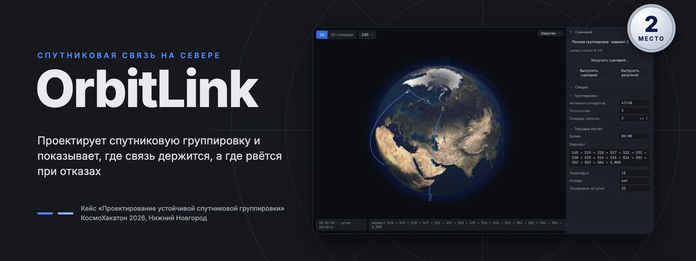
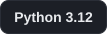
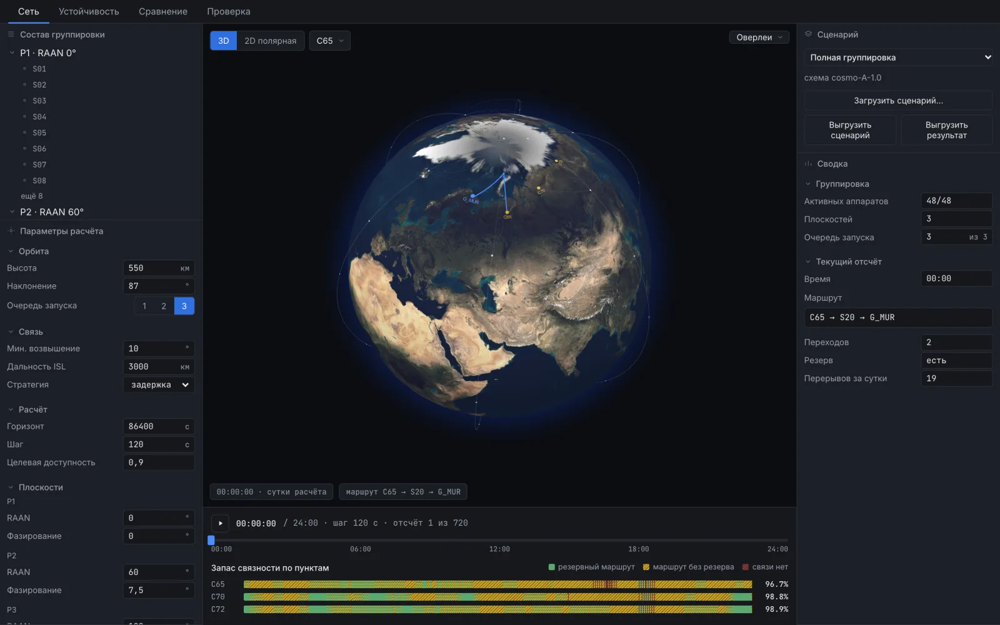
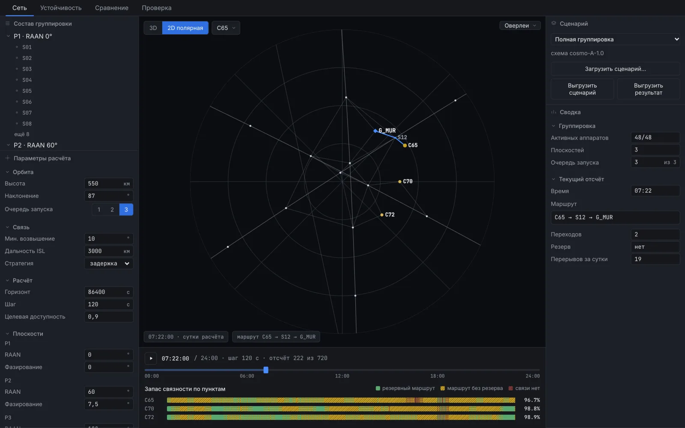
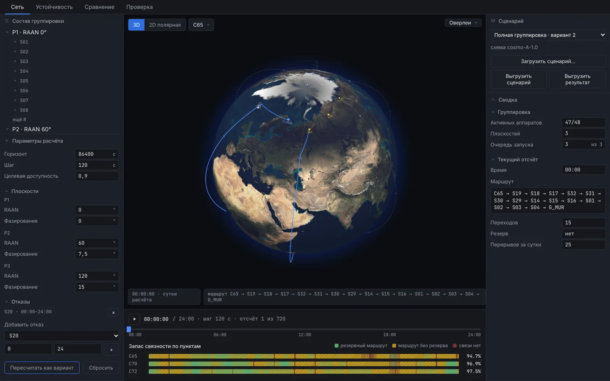
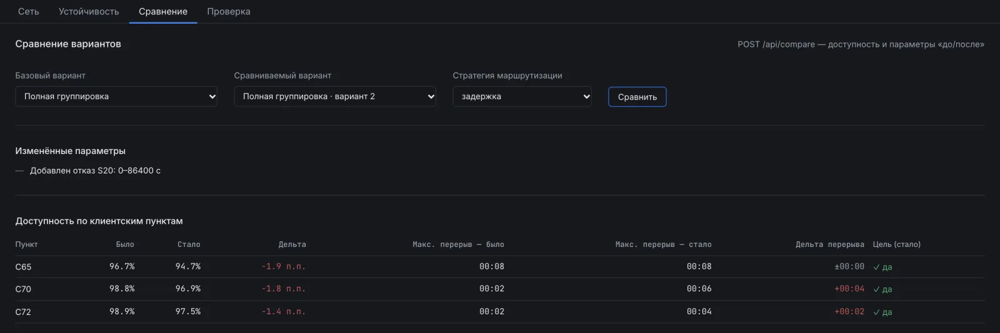
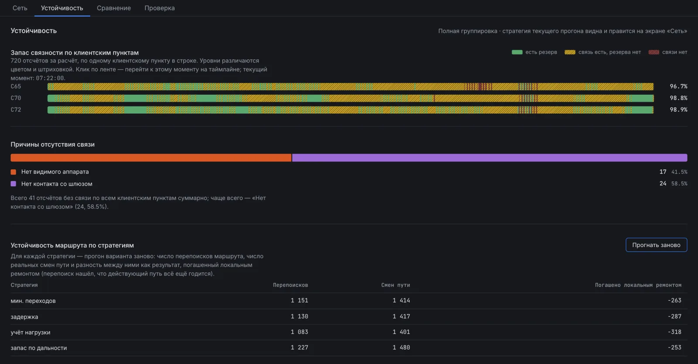
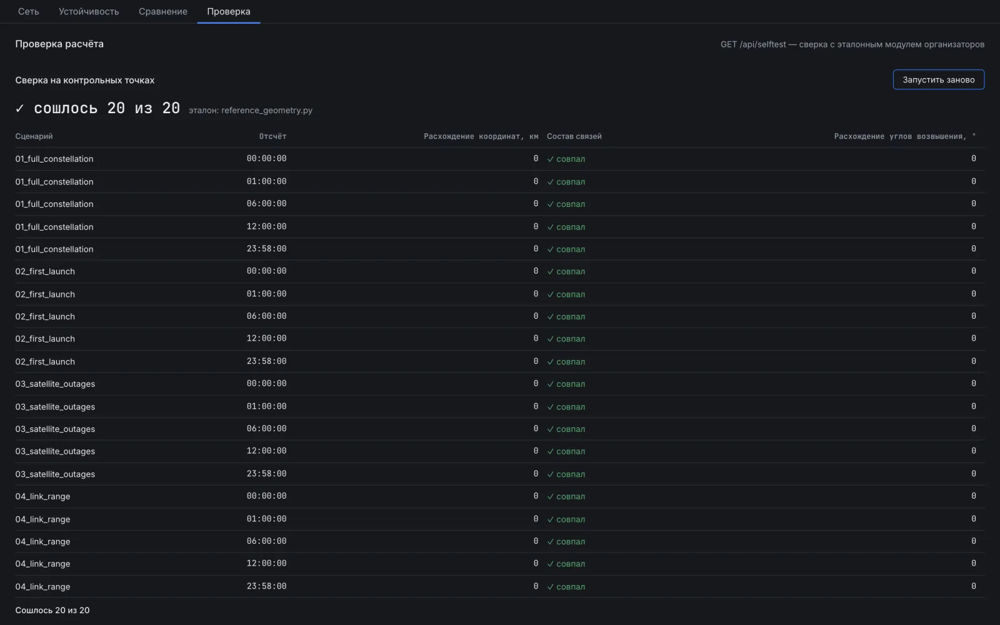
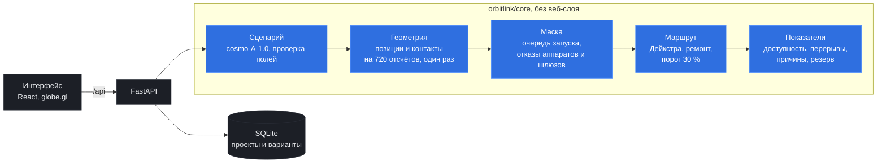

# OrbitLink

[](docs/presentation.pdf)

Веб-сервис для проектирования спутниковой группировки и оценки доступности связи в северных районах. Решение кейса «Проектирование устойчивой спутниковой группировки», **второе место** на КосмоХакатоне 2026 в Нижнем Новгороде.

Сервис загружает сценарий, считает покрытие наземных пунктов и сквозные маршруты «клиентский пункт → аппараты → шлюз», показывает поведение сети при отказах аппаратов и шлюзов и сравнивает варианты конфигурации.

        

> [!IMPORTANT]
> **Спутник над пунктом ещё не значит, что связь есть.** Данные должны дойти по цепочке аппаратов до шлюза в Мурманске, поэтому мы считаем долю суток, когда такой путь существует. Цель 90 % достижима только после третьей очереди запуска, когда на орбите все 48 аппаратов. И даже тогда запасной путь, не делящий с основным ни одного аппарата, есть лишь 16,5–36,8 % времени: остальное время связь держится на одной цепочке.

> [!NOTE]
> На время хакатона сервис был развёрнут на демо-стенде, сейчас стенд остановлен. Чтобы посмотреть всё вживую, поднимите сервис у себя: одна команда Docker Compose из раздела [«Запуск у себя»](#запуск-у-себя), дальше http://localhost:8080.

## Ссылки

| Что | Где | Зачем |
| --- | --- | --- |
| **Презентация** | [docs/presentation.pdf](docs/presentation.pdf) | 10 слайдов с защиты: подход, маршрутизация, развёртывание, пороги, отказы, рекомендации |
| Сценарии организаторов | [data/](data/) | Четыре сценария схемы `cosmo-A-1.0`, в интерфейсе это готовые пресеты |
| Эталонный модуль | [docs/reference_geometry.py](docs/reference_geometry.py) | Расчётный модуль организаторов. Источник истины в тестах и на экране «Проверка» |
| Испорченный сценарий | [docs/examples/invalid_scenario.json](docs/examples/invalid_scenario.json) | Показывает, как сервис сообщает об ошибках во входном файле |
| Описание API | http://localhost:8000/docs | Открывается после запуска |

## Критерии кейса: где это видно

| Критерий | Что сделали | Чем проверить |
| --- | --- | --- |
| **Проектирование и сравнение конфигураций** (15) | Очередь запуска 1, 2 или 3, высота, наклонение, угол возвышения, дальность межспутниковой связи, RAAN и фазирование каждой плоскости, отказы аппаратов. Каждая правка сохраняется отдельным вариантом, исходный сценарий не затирается. Сравнение показывает изменённые параметры и разницу доступности и перерывов по каждому пункту | Вкладка «Сравнение», скриншот ниже |
| **Анализ устойчивости** (10) | Ленты запаса связности по каждому пункту на 720 отсчётов: есть резерв, связь на единственном пути, связи нет. Причины отсутствия связи по четырём категориям из условия. Отказ одного аппарата в худшем случае снижает доступность на 3,5 п. п., отказ плоскости роняет её до 57,5–61,8 % | Вкладка «Устойчивость», раздел [«Что показали расчёты»](#что-показали-расчёты), слайды 8–9 |
| **Обоснованность рекомендаций** (10) | Четыре условия, при которых 90 % достижимы, и ограничения проекта. Каждое условие опирается на перебор, посчитанный ядром сервиса | Раздел [«Что показали расчёты»](#что-показали-расчёты), слайд 10 |
| **Удобство использования** (10) | Трёхмерный глобус и полярная проекция с видом на северный полюс. Таймлайн перематывает сутки без запросов к серверу. Клик по ленте переносит на этот момент времени | Скриншоты ниже, [сценарий демонстрации](#сценарий-демонстрации) из 7 шагов |
| **Презентация решения** (5) | Колода из 10 слайдов, живое демо на защите | [docs/presentation.pdf](docs/presentation.pdf) |
| **Корректность расчётов** (15) | Своё расчётное ядро, сверенное с модулем организаторов на 20 контрольных точках: расхождение координат 0,0 км, состав связей совпал, расхождение углов возвышения 0° | Вкладка «Проверка», `GET /api/selftest`, `tests/test_reference_parity.py` |
| **Алгоритмы маршрутизации** (15) | Дейкстра по графу контактов отсчёта. Маршрут сопровождается во времени: держится, пока цел и не хуже лучшего больше чем на 30 %, при разрыве одного ребра чинится обходом, иначе строится заново. Четыре стратегии выбора пути | Отказ S20 на скриншоте ниже, таблица стратегий на вкладке «Устойчивость», `tests/test_routing.py`, `tests/test_tracker.py` |
| **Работа с входными данными** (10) | Загрузка своего сценария: при ошибках сервис перечисляет проблемные поля. Варианты хранятся в SQLite. Выгрузка изменённого сценария загружается обратно без замечаний, результат выгружается в схеме `cosmo-A-result-1.0` | `docs/examples/invalid_scenario.json`, `tests/test_scenario.py`, `tests/test_export.py` |
| **Качество кода** (5) | Расчётное ядро `orbitlink/core` не зависит от веб-слоя. 301 тест бэкенда и 39 тестов интерфейса, black и ruff | Раздел [«Тесты»](#тесты) |
| **Документация и запуск** (5) | Запуск одной командой Docker Compose или бэкендом и интерфейсом по отдельности. Описание API, сценарий демонстрации | Раздел [«Запуск у себя»](#запуск-у-себя) |

## Как выглядит сервис

Скриншоты сняты с локального запуска этой версии на сценарии «Полная группировка».

<table>
  <tr>
    <td width="50%" valign="top"><b>Сеть на глобусе</b></td>
    <td width="50%" valign="top"><b>Полярная проекция</b></td>
  </tr>
  <tr>
    <td valign="top"></td>
    <td valign="top"></td>
  </tr>
  <tr>
    <td valign="top">Аппараты, наземные пункты, связи и выбранный маршрут. Внизу ленты по пунктам: зелёным отмечено время с резервным путём, янтарным без резерва, красным без связи.</td>
    <td valign="top">Вид с северного полюса. Пункты кейса лежат на широтах 65–72°, и на обычной карте мира они попали бы в зону самых сильных искажений.</td>
  </tr>
  <tr>
    <td width="50%" valign="top"><b>Отказ аппарата S20</b></td>
    <td width="50%" valign="top"><b>Сравнение вариантов</b></td>
  </tr>
  <tr>
    <td valign="top"></td>
    <td valign="top"></td>
  </tr>
  <tr>
    <td valign="top">S20 выключен на сутки, вариант пересчитан. В момент 00:00 маршрут от C65 идёт уже не через один аппарат, а через четырнадцать.</td>
    <td valign="top">Что поменяли и что стало с доступностью и перерывами. С отказом S20 цель держится у всех трёх пунктов: 94,7 %, 96,9 % и 97,5 %.</td>
  </tr>
  <tr>
    <td width="50%" valign="top"><b>Устойчивость</b></td>
    <td width="50%" valign="top"><b>Проверка расчёта</b></td>
  </tr>
  <tr>
    <td valign="top"></td>
    <td valign="top"></td>
  </tr>
  <tr>
    <td valign="top">Запас связности, причины отсутствия связи и прогон всех четырёх стратегий маршрутизации.</td>
    <td valign="top">Сверка с эталонным модулем организаторов на 20 контрольных точках запускается кнопкой.</td>
  </tr>
</table>

<details>
<summary><strong>Все возможности</strong></summary>

- **Сеть.** Положения аппаратов, наземные пункты, доступные связи и выбранный маршрут на трёхмерном глобусе или двумерной полярной проекции. Таймлайн перематывает сутки расчёта без запросов к серверу: позиции и связи по всем отсчётам приходят одним бинарным пакетом.
- **Редактирование конфигурации.** Очередь запуска, высота, наклонение, минимальный угол возвышения, дальность межспутниковой связи, RAAN и фазирование каждой плоскости, периоды недоступности аппаратов. Изменения проверяются и сохраняются отдельным вариантом, исходный сценарий не затирается.
- **Загрузка и выгрузка.** Собственный сценарий схемы `cosmo-A-1.0` из файла: при ошибках сервис перечисляет проблемные поля. Выгрузка изменённого сценария (загружается обратно без замечаний) и результата расчёта в схеме `cosmo-A-result-1.0`.
- **Устойчивость.** Ленты запаса связности по каждому пункту на 720 отсчётов. Разбор причин отсутствия связи по четырём категориям из условия: пункт не видит аппаратов, шлюз не видит аппаратов, шлюз выключен, сеть между ними разорвана. Сравнение четырёх стратегий маршрутизации.
- **Сравнение вариантов.** Изменённые параметры человекочитаемым списком и разница доступности и максимального перерыва по каждому пункту.
- **Проверка.** Сверка координат, состава связей и углов возвышения с эталонным модулем организаторов на двадцати контрольных точках, запускается кнопкой.

</details>

## Что показали расчёты

Все цифры посчитаны расчётным ядром этого репозитория, шаг 120 с. Цель в условии звучит как «не менее 90 % для каждого пункта», поэтому в выводах ниже везде берём доступность **худшего** из клиентских пунктов.

| Сценарий организаторов | C65 | C70 | C72 | Цель 90 % |
| --- | --- | --- | --- | --- |
| 01 Полная группировка, 48 аппаратов | 96,7 % | 98,8 % | 98,9 % | да |
| 02 Первая очередь, 16 аппаратов | 27,2 % | 15,8 % | 12,6 % | нет |
| 03 Отказ 10 аппаратов с 6-го часа | 79,3 % | 80,8 % | 82,5 % | нет |
| 04 Дальность межспутниковой связи 2000 км | 77,5 % | 62,2 % | 65,1 % | нет |

В сценарии 04 спутник над пунктом есть почти всегда, а сквозной путь до шлюза есть только 62,2–77,5 % времени. Узкое место в связности межспутниковой сети, а не в покрытии территории.

**90 % достижимы при четырёх условиях:**

| Условие | Почему |
| --- | --- |
| Выведены все три очереди, 48 аппаратов | После второй очереди доступность не выше 61,8 % при любой схеме развёртывания |
| Дальность межспутниковой связи больше 2700 км | Это расстояние между соседями в плоскости: `2·(R + h)·sin(180° / N)` = 2700,4 км при N = 16. При 2700 км доступность 85,6 %, при 2750 км уже 96,7 %. В проекте 3000 км, запас всего 300 км |
| Минимальный угол возвышения не выше 12° | При 12° доступность 92,9 %, при 13° уже 88,6 %. Горы и застройка поднимают угол |
| Каждая очередь запуска раскладывается по всем плоскостям | Доступность после второй очереди та же (61,7 % против 61,8 %), а максимальный перерыв 16 минут вместо 5 ч 30 мин |

**Отказы и уязвимые места:**

- Отказ любого одного аппарата на все сутки цель не ломает: в худшем случае 93,2 %, минус 3,5 п. п. Сильнее всего бьёт потеря S22, S27 и S29 в плоскости P2. Лишних аппаратов нет: отказ любого снижает доступность.
- Без целой плоскости доступность 57,5–61,8 %, перерывы до 5 ч 30 мин.
- Групповой отказ дальностью не лечится. В сценарии 03 в P1 выпали соседи S14, S15 и S16, в кольце дыра в четыре шага: при 3000 км доступность 79,3 %, при 4000 км только 80,6 %.
- Запасной путь без общих аппаратов есть 16,5 % времени у C65, 30,4 % у C70 и 36,8 % у C72.
- Стратегия маршрутизации на доступность не влияет: в сценарии 03 все четыре дают 79,3 %. Путь либо существует, либо нет, стратегия меняет только его качество и стабильность. Мы ожидали, что стратегия с запасом по дальности будет реже переключать маршрут, но это не подтвердилось.

**Рекомендации:** заложить резервные аппараты на орбите, в первую очередь в P2, и не урезать дальность межспутниковой связи ниже 3000 км.

Отдельных скриптов перебора в репозитории нет. Любую точку можно повторить в интерфейсе: поменять параметр и пересчитать вариант. Схемы развёртывания задаются полем `launch_batch` у аппаратов в файле сценария.

## Как устроено



- **Геометрия считается один раз.** Отказавший аппарат летит по той же орбите, поэтому позиции и контакты не зависят от отказов и очереди запуска. Они накладываются маской поверх, и геометрия переиспользуется во всех вариантах. Прогон суток занимает около секунды.
- **Маршрут ищется алгоритмом Дейкстры** по графу контактов текущего отсчёта и сопровождается во времени: сохраняется, пока цел и не хуже лучшего доступного больше чем на порог, при разрыве одного ребра чинится локальным обходом, иначе перестраивается. Стратегии: `min_hops`, `min_latency`, `load_aware` (обход занятых линий), `robust` (обход связей у предела дальности).
- **Корректность геометрии** проверяется автоматически против эталонного модуля организаторов: тестами и эндпоинтом `/api/selftest`.

<details>
<summary><strong>Расчётная модель и допущения</strong></summary>

- Круговые орбиты, сферическая Земля, единая для всех наземных пунктов граница угла возвышения.
- Межспутниковая связь определяется дальностью и тем, что линия не пересекает Землю. Наземные линии определяются углом возвышения.
- Наземные пункты не ретранслируют трафик: клиентский пункт всегда выходит в аппараты, шлюз является конечным узлом маршрута. При нескольких шлюзах маршрут строится до любого доступного.

</details>

<details>
<summary><strong>Карта репозитория</strong></summary>

| Каталог | Что внутри |
| --- | --- |
| `backend/` | Python 3.12, FastAPI, NumPy, SQLAlchemy. Расчётное ядро `orbitlink/core` не зависит от веб-слоя. 301 тест |
| `frontend/` | React 18, TypeScript, Vite. Трёхмерный глобус (globe.gl) и двумерная полярная проекция |
| `data/` | Четыре сценария организаторов, доступны в интерфейсе как готовые пресеты |
| `docs/reference_geometry.py` | Эталонный расчётный модуль организаторов, источник истины в тестах и на экране «Проверка» |
| `docs/examples/invalid_scenario.json` | Намеренно испорченный сценарий для демонстрации сообщений об ошибках |
| `docs/presentation.pdf` | Презентация с защиты |
| `deploy/` | Докерфайлы, compose, конфиг nginx, скрипт и настройки развёртывания на сервере |
| `media/` | Картинки для этого README, исходник шапки в `media/src/hero.html` |

</details>

## Запуск у себя

### Docker Compose, одной командой

Нужен только Docker.

```bash
docker compose -f deploy/docker-compose.yml up --build
```

Поднимаются два контейнера: интерфейс с nginx на http://localhost:8080 и бэкенд, к которому nginx проксирует `/api`. Порты меняются переменными `FRONTEND_PORT` и `BACKEND_PORT`. База хранится в томе `orbitlink-state` и переживает пересоздание контейнеров.

Остановить: `docker compose -f deploy/docker-compose.yml down`.

### Бэкенд и интерфейс по отдельности

Нужны Python 3.12 (минимум 3.10) и Node.js 20 или новее.

**Бэкенд:**

```bash
cd backend
python -m venv .venv && source .venv/bin/activate
pip install -e ".[dev]"
uvicorn orbitlink.api.app:app --reload
```

API поднимется на http://localhost:8000, документация на `/docs`. База SQLite задаётся переменной `ORBITLINK_DB` (по умолчанию `sqlite:///orbitlink.db`).

**Интерфейс**, в соседнем терминале:

```bash
cd frontend
npm ci
npm run dev
```

Интерфейс откроется на http://localhost:5173 и сам проксирует `/api` на `http://localhost:8000`. Если бэкенд запущен на другом порту, задайте адрес переменной: `ORBITLINK_API=http://localhost:8010 npm run dev`.

**Пути к данным.** При editable-установке (`pip install -e`, как выше) каталоги `data/` и `docs/reference_geometry.py` находятся автоматически. При обычной установке пакета процесс нужно запускать там, где рядом лежат `data/` и `docs/`, либо указать путь переменной `ORBITLINK_REPO_ROOT`. Если по этому пути нужных каталогов нет, сервис откажется запускаться сразу и назовёт причину.

### Проверить, что всё работает

```bash
curl -s localhost:8000/api/selftest | python3 -m json.tool | head
```

В ответе `"ok": true` и двадцать контрольных точек.

### Тесты

```bash
cd backend && python -m pytest tests/ -q
cd frontend && npx vitest run
```

Бэкенд: 301 тест проходит, 3 пропускаются по условию (на выбранном отсчёте нет маршрута, проверять нечего). Интерфейс: 39 тестов.

<details>
<summary><strong>Развёртывание на сервере</strong></summary>

Так сервис был развёрнут на время хакатона. Сервер общий с другими проектами: порты 80 и 443 держит системный Caddy, поэтому свой обратный прокси в compose не поднимается. Контейнеры OrbitLink слушают только `127.0.0.1`, наружу их выпускает Caddy. Настройки портов лежат в `deploy/svo.env`.

**1. Выкладка приложения** из корня репозитория:

```bash
bash deploy/deploy-svo.sh
```

Скрипт копирует исходники в `/opt/orbitlink`, собирает образы на сервере по одному, поднимает контейнеры и проверяет, что сверка с эталоном отвечает `ok`. Повторный запуск обновляет сервис.

**2. Домен** настраивается один раз, вручную. DNS-запись `nn-hac.kurligin.ru` должна указывать на адрес сервера. Затем на сервере:

```bash
sudo cp /etc/caddy/Caddyfile /etc/caddy/Caddyfile.bak-before-orbitlink
cat /opt/orbitlink/deploy/Caddyfile.orbitlink | sudo tee -a /etc/caddy/Caddyfile
sudo caddy validate --config /etc/caddy/Caddyfile
sudo systemctl reload caddy
```

Сертификат TLS Caddy получит сам при первом обращении к домену.

Для своего сервера замените домен в `deploy/Caddyfile.orbitlink` и настройки в `deploy/svo.env`. В этом файле есть строки `import sec_headers` и `import accesslog orbitlink`: это сниппеты из Caddyfile нашего сервера. Если у вас таких нет, удалите эти строки, иначе `caddy validate` выдаст ошибку.

</details>

## Сценарий демонстрации

Все шаги выполняются в интерфейсе, мышью.

1. **Полная группировка.** Открыть сервис: загружен сценарий «Полная группировка». В верхней панели вьюпорта выбрать клиентский пункт, например C65. Двигать таймлайн или нажать воспроизведение: маршрут на глобусе и в сводке справа меняется от отсчёта к отсчёту. Переключить вид «3D» и «2D полярная».
2. **Этап развёртывания.** В левой колонке, «Параметры расчёта», переключить очередь запуска с 3 на 1 и нажать «Пересчитать как вариант». Доступность в лентах под таймлайном падает до 12,6–27,2 %. Вкладка «Сравнение» по умолчанию сопоставляет новый вариант с исходным: видны изменённый параметр и разница доступности и перерывов.
3. **Отказ аппарата.** Посмотреть в сводке справа текущий маршрут, например `C65 → S20 → G_MUR`. Выбрать аппарат S20 в дереве «Состав группировки», в разделе «Отказы» добавить период его недоступности и пересчитать вариант: маршрут перестраивается через другие аппараты или возникает перерыв.
4. **Изменение проекта.** Изменить RAAN плоскости P2, например с 60 на 75, пересчитать и сравнить с предыдущим вариантом на вкладке «Сравнение». Нажать «Выгрузить сценарий», затем «Загрузить сценарий…» и выбрать этот же файл: он загружается без замечаний.
5. **Некорректный файл.** «Загрузить сценарий…» → `docs/examples/invalid_scenario.json`. Сервис перечисляет проблемные поля: шаг расчёта, ссылку на несуществующую плоскость, широту вне диапазона, неизвестный аппарат в отказе, перевёрнутый период.
6. **Устойчивость.** Вкладка «Устойчивость»: ленты запаса связности показывают, сколько времени связь держится на единственном пути, диаграмма причин показывает, из-за чего пропадает связь. «Прогнать все стратегии» сравнивает четыре стратегии маршрутизации.
7. **Проверка расчёта.** Вкладка «Проверка», «Запустить проверку»: двадцать контрольных точек сверяются с эталонным модулем организаторов.

<details>
<summary><strong>Описание API</strong></summary>

| Метод и путь | Назначение |
| --- | --- |
| `GET /api/presets` | Четыре сценария организаторов с полным содержимым |
| `POST /api/scenarios/validate` | Проверка сценария без сохранения: `ok` и список `issues` с путём и сообщением |
| `POST /api/projects` | Создать проект, базовый вариант совпадает с переданным сценарием; невалидный даёт `422` |
| `GET /api/projects`, `GET /api/projects/{id}` | Список проектов и проект целиком |
| `POST /api/projects/{id}/variants` | Создать вариант; в ответе дифф параметров относительно базового сценария |
| `GET /api/variants/{id}`, `PATCH /api/variants/{id}` | Вариант с диффом; обновление заголовка или сценария |
| `POST /api/variants/{id}/run` | Прогон (`strategy`, `hysteresis`, `with_backup`), кэшируется по отпечатку конфигурации |
| `GET /api/variants/{id}/export` | Результат в схеме `cosmo-A-result-1.0` с теми же параметрами, что и прогон |
| `GET /api/variants/{id}/snapshot?t_s=` | Состояние сети в один момент времени |
| `GET /api/variants/{id}/network` | Позиции и связи на всей сетке времени одним бинарным пакетом |
| `POST /api/compare` | Сравнение двух вариантов: доступность и максимальный перерыв до и после, изменённые параметры |
| `GET /api/selftest` | Сверка расчётного ядра с эталонным модулем организаторов |

</details>

## Ограничения

- **Модель из условия задачи:** сферическая Земля, круговые орбиты, единый для всех пунктов порог угла возвышения. Атмосферу, рельеф и пропускную способность линий показатели не учитывают.
- **Однопользовательский сервис:** прогон синхронный, состояние в SQLite, входа и разграничения доступа нет.
- **Переборы для выводов** (дальность, угол, отказ каждого аппарата, схемы развёртывания) считались ядром отдельно. В интерфейсе каждую точку можно повторить, но одной кнопкой весь перебор не запускается.
- **Наземные пункты не ретранслируют трафик,** а сравнение вариантов идёт по доступности и перерывам, без стоимости группировки.

Команда «Рапира Клауд», второе место на КосмоХакатоне 2026 в Нижнем Новгороде.
